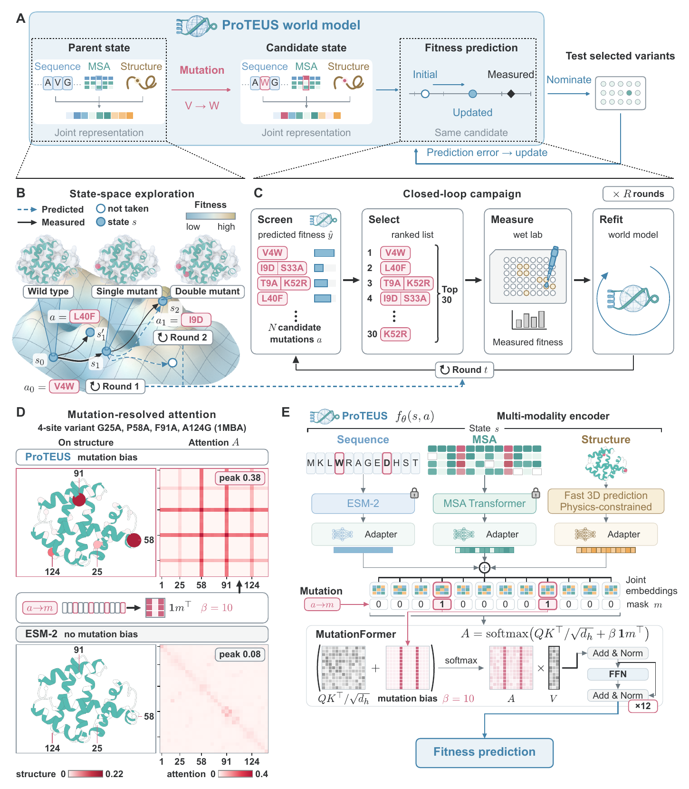

<div align="center">

# ProTEUS

**A mutation-resolved world model for closed-loop protein evolution**

[](https://yikunpku.github.io/ProTEUS/)
[](https://yikunpku.github.io/ProTEUS/#film)
[](https://arxiv.org/abs/2611.13348)

</div>

<!-- TABLE OF CONTENTS -->
<details open>
  <summary><strong>Table of Contents</strong></summary>
  <ol>
    <li><a href="#about-the-project">About The Project</a></li>
    <li>
      <a href="#install">Install</a>
      <ul>
        <li><a href="#uv">uv</a></li>
        <li><a href="#docker">Docker</a></li>
        <li><a href="#conda">conda</a></li>
        <li><a href="#four-things-to-get-right">Four things to get right</a></li>
      </ul>
    </li>
    <li><a href="#skill-for-coding-agents">Skill for coding agents</a></li>
    <li>
      <a href="#quick-start">Quick start</a>
      <ul>
        <li><a href="#get-the-weights">Get the weights</a></li>
        <li><a href="#score-variants-zero-shot">Score variants zero-shot</a></li>
        <li><a href="#run-one-round">Run one round</a></li>
        <li><a href="#a-protein-of-your-own">A protein of your own</a></li>
      </ul>
    </li>
    <li><a href="#one-round-step-by-step">One round, step by step</a></li>
    <li><a href="#configuration">Configuration</a></li>
    <li><a href="#project-structure">Project structure</a></li>
    <li><a href="#hardware">Hardware</a></li>
    <li><a href="#license">License</a></li>
  </ol>
</details>

## About The Project

ProTEUS is a world model for closed-loop **PROT**ein **E**volution with high
m**U**tation re**S**olution.



Protein engineering has to cross a rugged fitness landscape, where a single
substitution can change function sharply, while experimental screening only
ever samples a vanishing fraction of sequence space. The combinatorial part of
that space has to be traversed in silico.

ProTEUS treats it as a world model. A variant is a **state** in a joint latent
space of sequence, evolutionary and structural information; a mutation is an
**action**; and the model predicts the functional consequence of taking it.
Resolving the mutation itself rather than the sequence alone is what lets one
model serve a whole combinatorial library, and what makes a *trajectory*
through that library something you can evaluate before committing a single
well to it.

One round goes: measure a batch; train a surrogate on what came back; fuse it
with a zero-shot prior and with the fitness already proven for each candidate's
sub-variants; propose the next batch one mutation deeper. Depth is an argument,
not a code path: round 5 is the same command as round 2.

## Install

Three paths, decided by two binaries that are not on PyPI: `pymol` (builds the
mutant structures) and `hhfilter` (filters alignments).

|                  | Python side | `pymol`     | `hhfilter`  | pinned by                |
| ---------------- | ----------- | ------------- | ------------- | ------------------------ |
| **uv**     | yes         | no            | no            | `uv.lock`, with hashes |
| **Docker** | yes         | **yes** | **yes** | image + `uv.lock`      |
| conda            | yes         | yes           | yes           | version ranges only      |

### uv

```bash
uv sync --frozen                        # exact versions, by hash
uv run python tools/install_fair_esm.py # required -- see below
uv run proteus-doctor                   # non-zero exit on a real problem
```

### Docker

```bash
docker build -t proteus .
docker run --rm -it --gpus all --user "$(id -u):$(id -g)" -e HOME=/tmp \
  -v "$PWD/examples":/work/examples \
  -v "$HOME/.cache/torch":/tmp/.cache/torch \
  -v "$HOME/.cache/huggingface":/tmp/.cache/huggingface \
  -e HF_TOKEN proteus proteus-doctor
```

About 11 GB. Keep `--user`, or files written into a bind mount are owned by
root on the host.

### conda

```bash
conda env create -f environment.yml     # or: mamba env create -f ...
conda activate proteus
pip install -e .
python tools/install_fair_esm.py
```

### Four things to get right

- `scikit-learn` is pinned to **1.6.1**. Another minor release nominates a
  different batch from the same labels.
- `tools/install_fair_esm.py` is not optional. Meta's ESM and
  EvolutionaryScale's ESM3 both ship a top-level `esm`; ProTEUS needs both, so
  this installs Meta's as `fair_esm`. `pip install fair-esm esm` leaves you
  with whichever landed second.
- Run `proteus-doctor` first, and again after any failure that looks like an
  environment problem. It probes behaviour, not version strings.
- ESM3's weights are gated: accept the terms on
  [EvolutionaryScale/esm3](https://huggingface.co/EvolutionaryScale/esm3-sm-open-v1)
  and `huggingface-cli login`. On `CERTIFICATE_VERIFY_FAILED`, fix the trust
  store (`pip install -U certifi`, or `SSL_CERT_FILE`). Do not disable
  verification.

## Skill for coding agents

`.claude/skills/proteus-pipeline/` is a skill: this pipeline written for a
coding agent. Claude Code and Codex read the same format and differ only in
where they look for it.

|                       | where it looks                                        | what to do                                                   |
| --------------------- | ----------------------------------------------------- | ------------------------------------------------------------ |
| **Claude Code** | `<repo>/.claude/skills/`                            | nothing; it is already there inside a checkout               |
|                       | `~/.claude/skills/`                                 | for use from outside the repository, run the installer below |
| **Codex**       | `$CODEX_HOME/skills/`, default `~/.codex/skills/` | run the installer below                                      |

```bash
.claude/skills/proteus-pipeline/install.sh          # copy into both
.claude/skills/proteus-pipeline/install.sh --link   # symlink, so repo edits apply
.claude/skills/proteus-pipeline/install.sh --check  # report what is installed where
.claude/skills/proteus-pipeline/install.sh --uninstall
```

Then ask for the work, or invoke it by name (`/proteus-pipeline` in Claude
Code). It prints the plan with its GPU cost and stops for you to confirm; only
`proteus-doctor` and `proteus-audit` run unprompted.

## Quick start

[examples/](examples/README.md) runs one closed-loop round on **CreiLOV**, a
119-residue LOV-domain fluorescent protein from CombinGym.

### Get the weights

[yikuuun/proteus](https://huggingface.co/yikuuun/proteus) on Hugging Face.

```bash
hf download yikuuun/proteus proteus_release.pth proteus_release.pth.sha256 --local-dir weights
cd weights && sha256sum -c proteus_release.pth.sha256 && cd ..
```

8.06 GiB. `featurize.embed` is the only step that requires them.

### Score variants zero-shot

```bash
proteus-score --dms-file data/my_protein.csv --checkpoint weights/proteus_release.pth \
              --msa-dir data/msa --structure-dir data/structure \
              --output-file results/my_protein.csv
```

Input is a DMS-style CSV (`mutant`, `mutated_sequence`, a `wild_type` row) plus
an MSA and a structure found by the CSV's stem; output is the same table with a
`Proteus_score` column. This scorer is an ensemble of three frozen third-party
models, not the trunk.

### Run one round

```bash
CFG=my_config.yaml; KEY=MY_PROTEIN; D=2
CKPT=weights/proteus_release.pth

# every path below the registry is derived; ask the config rather than guess
LIB() { python -c "from proteus.config import ProteusConfig as C; print(C.from_yaml('$CFG').library_for('$KEY', $1))"; }
ZS()  { python -c "from proteus.config import ProteusConfig as C; print(C.from_yaml('$CFG').zeroshot_csv('$KEY', $1))"; }

proteus-candidates --config $CFG --protein $KEY --depth $D

for d in $(seq 1 $D); do
  proteus-score --dms-file "$(LIB $d)" --output-file "$(ZS $d)" --checkpoint $CKPT \
                --msa-dir proteins/$KEY/msa --structure-dir proteins/$KEY/structure

  for S in structure_prep sequence mask; do          # no --device on these
    python -m proteus.featurize.$S --config $CFG --protein $KEY --depth $d
  done
  for S in structure_tokens msa; do
    python -m proteus.featurize.$S --config $CFG --protein $KEY --depth $d --device cuda:0
  done
  python -m proteus.featurize.tars  --config $CFG --protein $KEY --depth $d
  python -m proteus.featurize.embed --config $CFG --protein $KEY --depth $d \
         --checkpoint $CKPT --device cuda:0
done

proteus-select --config $CFG --protein $KEY --depth $D --write-pool
proteus-audit  --config $CFG --protein $KEY --depth $D
```

Every depth from 1 to D is scored and featurized, not just the newest,
because the surrogate trains on the measured variants' embeddings.

`--device` is taken by `structure_tokens`, `msa` and `embed` only, and their
defaults disagree (`msa` is `cpu`, the other two `cuda:0`); passing it to the
other four is an argparse error. Set it explicitly and keep it fixed for a
campaign. Same for dtype: `embed --dtype bfloat16` (the GPU default) versus
`float32` moved one round's fraction-of-truth from 0.700 to 0.767. On CPU,
`embed` needs `--dtype float32`.

`proteus-audit` is 24 or 25 checks over the state on disk and exits non-zero on
any failure. Run it before you order anything.

### A protein of your own

```bash
proteus-prepare --config cfg.yaml --protein MY_PROTEIN --fasta wt.fasta --register
```

Searches an MSA, predicts the wild-type structure, checks the three
descriptions of the protein against each other, writes the registry entry. The
default MSA backend **sends your sequence to a public server**. For anything
unpublished use `--msa af3-zip` or `--msa a3m`.

`--structure boltz` is the default and needs `proteusfold/` in its own
virtualenv:

```bash
cd proteusfold && uv venv && uv pip install -e . && cd ..
export PROTEUS_BOLTZ="$PWD/proteusfold/.venv/bin/boltz"
```

Without it, import one: `--structure pdb --structure-source wt.pdb`,
`--structure rcsb --structure-source 3BYJ`, or `--structure af3-zip --structure-source fold_job.zip`. `featurize.structure_predict` folds every
mutant instead of mutating the wild type with PyMOL.

## One round, step by step

```
measured labels ──> candidates ──> zero-shot ──┐
                         │                     ├──> nominate ──> audit ──> order
                         └──> featurize ───────┘
```

**Featurize** builds one mutant structure per candidate, then four streams
(ESM2 sequence tokens, ESM3 structure tokens, an ESM-MSA-1b alignment embedding,
and the mutation mask), and runs the trunk to get one vector per variant. The
trunk is MutationFormer: a 12-layer fusion encoder that aligns the three
feature types residue by residue, with attention biased toward the mutations.
The mutation mask is the stream that supplies that bias.

**Nominate** (`proteus-select`) gives each unseen candidate three normalized
ranks.

| channel       | signal                                                                 |
| ------------- | ---------------------------------------------------------------------- |
| `rank_rf`   | random forest on the measured variants' trunk embeddings (supervised) |
| `rank_zs`   | the zero-shot score, or the sum over the variant's measured singles    |
| `rank_base` | the best fitness already measured among the candidate's sub-variants   |

They fuse as `a_zs·rank_zs + a_rf·rank_rf + a_base·rank_base`, with
`a_rf = 1 − a_zs − a_base`. One choice of weights would be arbitrary, so the
ordered batch is a **consensus**: five settings
`(a_zs, a_base) ∈ {(0,.6), (0,.2), (.2,.2), (0,.4), (.2,.4)}` each contribute a
top-N, and candidates rank by how many of those lists they appear in.

`rank_zs` and `rank_base` rank within each depth, since neither is comparable
across depths.

## Configuration

One YAML registers proteins and their three static inputs. Everything else
(rounds, workspaces, outputs) is derived from `root` and the depth.

```yaml
root: .
proteins:
  MY_PROTEIN:
    library_csv: libraries/MY_PROTEIN.csv
    wt_pdb:      proteins/MY_PROTEIN/structure/MY_PROTEIN.pdb
    msa_a3m:     proteins/MY_PROTEIN/msa/MY_PROTEIN.a3m
    crop: dataset          # dataset | per-variant
```

Labels are yours to write: `variant,fitness`, wild type at exactly 1.0, at
`rounds/round<D-1>/labels/<key>.csv` for a round at depth D.

## Project structure

```
proteus/
    config.py        protein registry, depth-parameterized layout, crop windows
    models/          the trunk: fusion encoder, adapters, regression head
    zeroshot/        the ESM ensemble scorer and its MSA sampling
    featurize/       mutant structures -> four streams -> shards -> embeddings
    al/              candidates, surrogate, three-channel selection, consensus
    prepare/         MSA and structure backends, alignment shape, input checks
    cli/             score, candidates, select, audit, doctor, prepare
    third_party/     vendored ProteinGym/EVE, fair-esm and ColabFold code
tools/               install_fair_esm.py, strip_checkpoint.py
examples/            the CreiLOV demo, end to end
docs/img/            the figure above
.claude/skills/      a skill that lets a coding agent drive the pipeline
proteusfold/         the structure predictor: a Boltz fork with a differentiable
                     Gauss-Seidel projection
```

MutationFormer pretraining is not in this repository.

## Hardware

`proteus-score` holds all three frozen encoders at once: ESM2-3B (2.84 B
parameters), ESM-MSA-1b (0.12 B) and ESM3 (~1.4 B). That is **16.2 GiB of
fp32 weights** before activations. Measured: a card with 18 GiB free was not
enough. It is also one forward pass per residue per MSA sample, so CPU is hours.
`featurize.embed` is separate and smaller: the 8.06 GiB checkpoint, plus the
trunk, which is negligible.

PyMOL is CPU-bound and parallel. An MSA search needs no GPU, so
`proteus-prepare --msa colabfold --structure pdb --structure-source wt.pdb`
works on a laptop.

Featurization shards across GPUs with `--task-id/--total-tasks`, except
`structure_prep`, which parallelizes with `--workers`.

## License

[LICENSE](LICENSE) is Foundry Biosciences' Internal Research End User
Agreement: free for academic and internal research, no commercial use, no
redistribution, and no use in humans or clinical research. Commercial terms are
a separate agreement (licensing@foundrybio.ai).

Two parts of this repository carry their own terms, which the agreement's
Section 3 preserves.

| | terms |
|---|---|
| the eight files derived from [ml-4m](https://github.com/apple/ml-4m), by EPFL and Apple Inc. | Apache-2.0, text retained in [LICENSE.apache-2.0](LICENSE.apache-2.0) |
| `proteusfold/`, a fork of [Boltz](https://github.com/jwohlwend/boltz) | MIT, see [proteusfold/LICENSE](proteusfold/LICENSE). Its `predict.py` and `tools/clean_a3m.py` were written here and are governed by `LICENSE` instead |

Also vendored, each file naming its source in a header:
[ProteinGym](https://github.com/OATML-Markslab/ProteinGym),
[EVE](https://github.com/OATML-Markslab/EVE),
[ColabFold](https://github.com/sokrypton/ColabFold),
[ESM](https://github.com/facebookresearch/esm),
[timm](https://github.com/huggingface/pytorch-image-models). ESM2, ESM-MSA-1b
and ESM3 are downloaded at run time, not shipped here.
